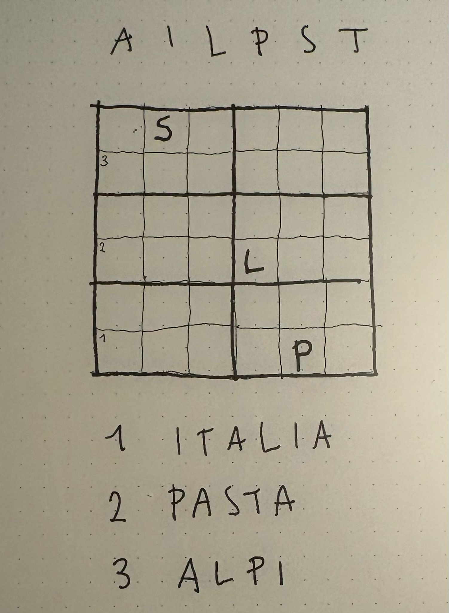
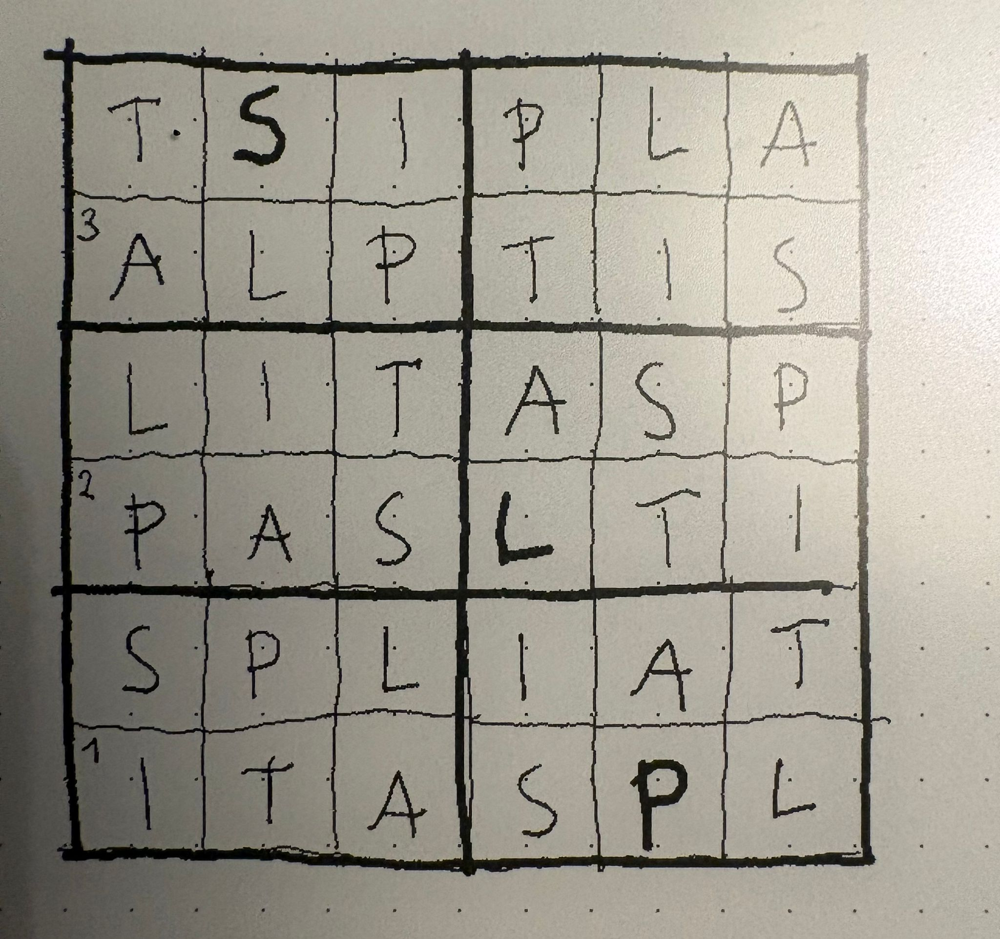

# Puzzlepaw

A collection of small tools for crafting logic puzzles, written in
[Nim](https://nim-lang.org).

## Motivation

After spending time solving logic puzzles — inspired by Thomas Snyder's work on
[Grand Master Puzzles](https://www.gmpuzzles.com) — I started designing puzzles
by hand. That manual process taught me the craft. Now I want to build lightweight
tools to support the creative side of puzzle construction: validating grids,
checking constraints, and exploring variations faster than pen and paper allow.

This project grows incrementally. Each tool solves one small, concrete problem
in the puzzle-making workflow. It also doubles as a first experiment with
[Claude Code](https://claude.ai/claude-code) as a development companion.

## Parloku

Parloku is a mini sudoku variant that uses letters instead of numbers and
adds word-based hints as an extra layer of deduction.

### Rules

1. Fill a 6x6 grid with six distinct letters so that each letter appears
   exactly once in every row, column, and 2x3 box — standard sudoku rules.
2. A list of words is provided alongside the grid. Each word has a numbered
   starting cell marked in the grid.
3. Starting from that cell, the word is spelled out step by step, moving
   horizontally or vertically to an adjacent cell at each step.

Some cells may contain pre-filled letters as additional givens.

### Example

In this example the six letters are **A, I, L, P, S, T** and the word hints
are ITALIA, PASTA, and ALPI — all Italian words, reflecting the puzzle's
Italian origin.



<details>
<summary>Show solution</summary>



</details>

### Playtest TUI

A terminal-based player is included for playtesting puzzles. Run it with:

```sh
nim play
```

The TUI displays the puzzle grid with colored word hint markers. Use arrow
keys to navigate, type a letter to place it, and backspace to clear.

```text
Letters: A I L P S T

+-------+-------+
| . S . | . . . |
| 3 . . | . . . |
+-------+-------+
| . . . | . . . |
| 2 . . | L . . |
+-------+-------+
| . . . | . . . |
| 1 . . | . P . |
+-------+-------+

Word hints:
  1. ITALIA
  2. PASTA
  3. ALPI
```

### Solver and builder tools

`src/parloku/solver.nim` is a small constraint solver meant to help design
puzzles: pick some words and givens, and ask how many grids fit.

- `countSolutions(p, limit)` / `solve(p, opts)` / `isUnique(p)`: count and
  list solutions (sudoku propagation plus word-path pruning, so a puzzle with
  three words and no givens is solved in milliseconds).
- `candidates(p)`: for each cell, the letters it takes in at least one
  solution. Cells with a single candidate are already forced; the others are
  where a given would help.
- `wordStarts(p, word)`: every cell where a new word could start, with how
  many solutions each choice leaves (most constraining first).
- `checkGrid(p, grid)` / `wordPaths(grid, hint)`: validate a filled grid and
  show how each word is read.
- `validate(p)`: catch letters not in the set, double letters (impossible on
  adjacent cells), hints outside the grid.
- `SolveOptions.allowRevisit` / `allowShared`: by the rules paths may
  revisit cells and words may share cells; switch these off to check a
  puzzle is also unique under the stricter "elegant" reading.

`src/parloku/code.nim` encodes a problem as a short URL-safe code,
`LETTERS_GIVENS_WORDS` with 0-based `<row><col>` prefixes, for example
`AILPST_01S.33L.54P_50ITALIA.30PASTA.10ALPI` for the puzzle above. Both
modules have no OS dependencies and compile with `nim js`, so a browser
builder page can reuse them.

From the command line:

```sh
nim r -d:release src/pzlsolve.nim data/puzzle1-ITALIA-PASTA-ALPI.json
nim r -d:release src/pzlsolve.nim AILPST__50ITALIA.30PASTA.10ALPI   # no givens: 42 solutions
nim r -d:release src/pzlsolve.nim AILPST__50ITALIA.30PASTA --starts:ALPI
```

An illustrated walk-through of the solver, with live outputs and an in-browser
builder preview, is a [nimib](https://github.com/pietroppeter/nimib) notebook in
`docs/solver.nim`. Build it with `cd docs && sh deps.sh && nim c -r -d:release solver.nim`
(writes `docs/index.html`; needs PCRE1, e.g. `libpcre3`).

## Claude session logs

This project is developed with [Claude Code](https://claude.ai/claude-code).
Session logs are kept in the [claude/](claude/) folder, documenting what was
built, decisions made, and lessons learned in each session.
